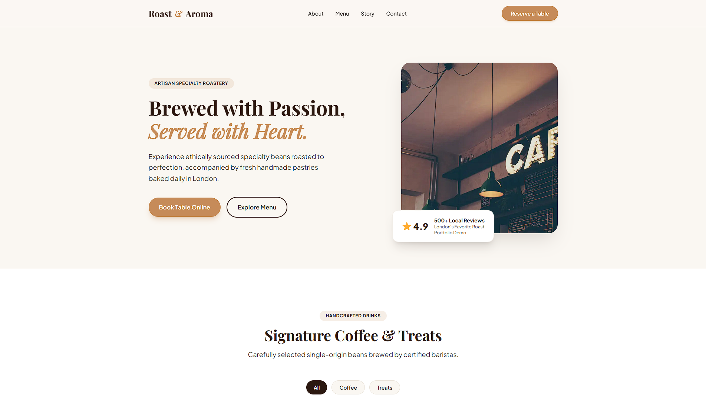

# Roast & Aroma — Custom WordPress Theme

A modern, high-performance WordPress theme for a specialty coffee roastery, built from a custom static design using Tailwind CSS and native WordPress APIs.

## Overview

This project demonstrates the transition from a static front-end landing page to a fully dynamic, client-manageable WordPress theme. It replaces hardcoded elements with database-driven content, dynamic loops, and native CMS controls.

## Key Features

- **Dynamic Catalog Architecture**: Product cards (coffee drinks & artisan treats) are managed as WordPress posts and pulled dynamically using custom `WP_Query` loops.
- **Custom Meta Fields**: Pricing is controlled individually for each item via custom post metadata.
- **Category Filtering**: Seamless front-end categorization (`Coffee`, `Treats`) hooked directly into post taxonomy.
- **Native Navigation**: Header navigation is powered by WordPress `wp_nav_menu()` for effortless site structure management.
- **Clean Enqueue System**: Styles and compiled Tailwind assets are integrated through standard `wp_enqueue_scripts` hooks in `functions.php`.
- **Interactive UI**: Includes interactive category filters and a custom table reservation modal.

## Tech Stack

- **Backend**: PHP, WordPress Core API (`WP_Query`, Meta Boxes, Theme Support)
- **Frontend**: Tailwind CSS, Vanilla JavaScript (ES6+)
- **Environment**: LocalWP, Nginx, MySQL

---
*Created as part of a custom WordPress theme development portfolio.*
